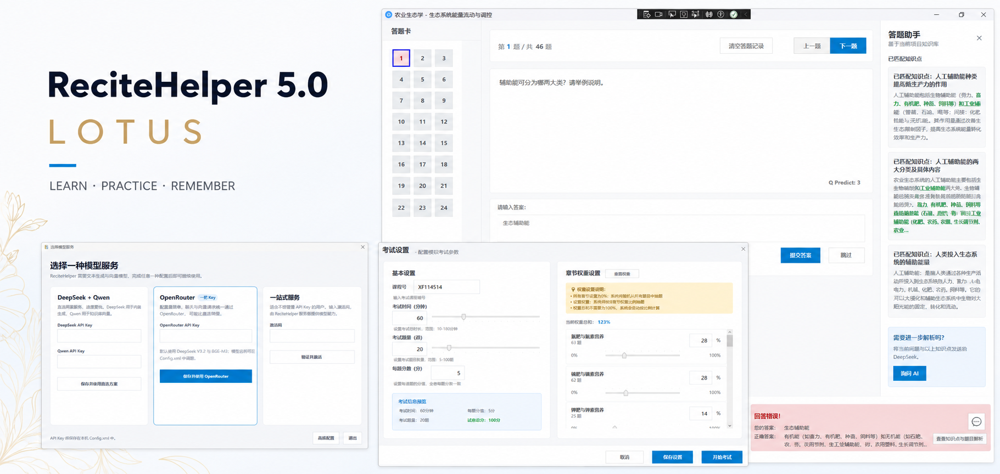
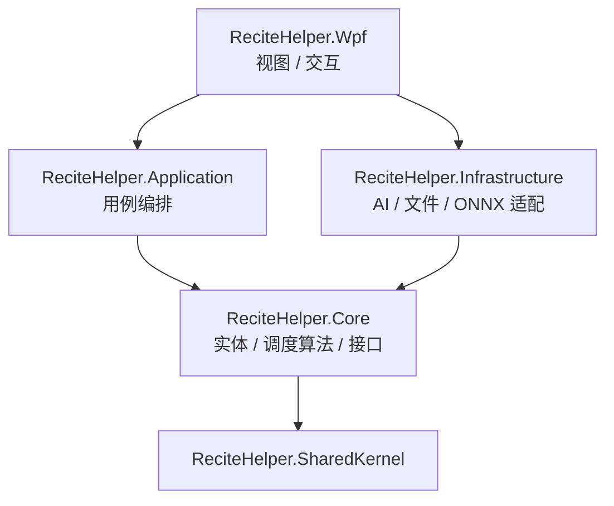

<p align="center">
  
</p>

<p align="center">
  <strong>简体中文</strong> · <a href="README_EN.md">English</a>
</p>

<h1 align="center">ReciteHelper</h1>

<p align="center">
  <strong>把课程资料变成真正可以练习、检索和复习的学习项目。</strong>
</p>

<p align="center">
  <a href="https://github.com/ClassTechStar/ReciteHelper/actions/workflows/dotnet.yml"></a>
  <a href="LICENSE"></a>
  
  
  
</p>

<p align="center">
  <a href="https://github.com/ClassTechStar/ReciteHelper/releases"><strong>下载 ReciteHelper</strong></a>
  · <a href="docs/manual-cn.md">用户手册</a>
  · <a href="docs/Dev/architecture.md">技术架构</a>
  · <a href="docs/algorithm-cn.md">复习算法说明</a>
  · <a href="https://github.com/ClassTechStar/ReciteHelper/issues">问题反馈</a>
</p>

ReciteHelper 是一款面向考试复习、课程学习与知识整理的开源 Windows 桌面应用。它使用 AI 读取学习资料、提取知识点并生成题目，再通过本地知识库、智能判分、错题解析和 FSRS-6 个性化调度，形成从资料到长期记忆的完整学习闭环。

AI 在 ReciteHelper 中不是一个孤立的聊天框。它参与资料解析、题目生成、知识检索和错题辅助；章节、题库、学习记录与知识库则随项目文件一起保存在本地。

## 核心创新

**1. FSRS-6 记忆模型与个性化拟合**
内置公开记忆研究界最新的 FSRS-6（Difficulty–Stability–Retrievability）调度器：为每道题维护三维记忆状态，按遗忘曲线预测回忆概率，并把「预测回忆率跌破目标保留率」的题目视为到期。项目累计约 800 次有效作答后，会在后台用用户自己的作答历史重新拟合 21 个模型参数（约一秒完成），只有拟合结果更优时才启用。算法说明见[复习算法说明](docs/algorithm-cn.md)，实现位于 `Core/Scheduling/`。

**2. 无感化 AI 全流程**
AI 深度参与五个环节：资料文本抽取 → 知识点分块摘要 → 题目生成与后处理修复 → 本地向量知识库 → 错题检索与解析。全过程无需用户面对一个"聊天框"。

**3. 离线语义判分**
名词解释与解答题由本地 ONNX SBERT 模型判分（会话常驻缓存 + 结果缓存），无网络、无 API Key 也可用；模型缺失时自动降级到字符级相似度算法。练习与考试使用同一套语义判分标准。

**4. 项目级文件知识库**
每个学习项目自带一个文件型向量知识库：AI 生成的原子知识点 + 向量，随 `.rhproj` 一起保存、导入、导出。不需要部署数据库或向量服务；向量来源不一致时自动重嵌入修复。

**5. 三种模型接入方式**
DeepSeek + Qwen 直连、单 Key OpenRouter、激活码托管服务三选一，全部由统一的 `ModelAccess` 状态机路由；API 端点与模型名可在配置文件中覆盖。

**6. 面向数据正确的工程细节**
`.rhproj` 带格式版本号与迁移器、原子写入；知识库聚类主键修复（杜绝静默丢知识点）；配置文件自动迁移到 `%APPDATA%` 并以 DPAPI 加密存储 API Key；资源中心下载的压缩包经大小/类型/manifest 校验后才导入。

## 5.0 Lotus

5.0 版本围绕“从资料到掌握”重新整理了学习流程：

- **FSRS-6 科学复习**：根据难度、记忆稳定度和距上次复习的时间预测回忆概率，优先安排即将遗忘的题目；积累足够记录后可自动拟合个人参数。
- **五类题型**：选择、填空、判断、名词解释与解答题使用各自适合的交互和判分方式。
- **整卷导入与考试闭环**：从 PDF、TXT、HTML 或 MHTML 识别多套试卷，支持章节权重组卷、限时考试、自动评分和错题回顾。
- **项目级本地知识库**：为每个项目建立独立的文件型向量知识库，错题时检索相关知识点并按需生成 AI 解析。
- **更灵活的模型接入**：支持 DeepSeek + Qwen 直连、单 Key 的 OpenRouter，以及激活码托管服务三种方案。

## 工作流

```text
导入课程资料 → AI 提取知识与生成题目 → 练习 / 模拟考试
      → 错题检索与解析 → FSRS-6 安排下一次复习
```

## 技术架构

ReciteHelper 采用 Clean Architecture 分层，业务核心不依赖任何 UI 或第三方 SDK：



| 层 | 职责 | 代表模块 |
| --- | --- | --- |
| Core | 领域实体、FSRS-6 调度数学、判分归一化、全部服务接口（零第三方依赖） | `Scheduling/FsrsAlgorithm`、`Services/FillBlankTextNormalizer` |
| Application | 用例编排：出题、判分、复习调度、个性化拟合 | `ProjectCreationService`、`QuizService`、`FsrsReviewScheduler` |
| Infrastructure | 适配器：LLM SDK、ONNX 推理、文件向量库、配置加密 | `KnowledgeBaseService`、`SbertModelJudge`、`ConfigService` |
| Wpf | 视图与交互，DI 组装 | 17 个窗口、FlashCard 学习模式 |

详细分层说明、数据流与安全设计见[技术架构文档](docs/Dev/architecture.md)。

## 工程质量

- **自动化测试**：xUnit 单元测试覆盖 FSRS-6 数学不变量、判分归一化、组卷策略、向量库、配置持久化等核心逻辑，CI（GitHub Actions）每次推送自动执行构建 + 测试。
- **发布工程**：`build.ps1` 一键发布（去除 PDB、生成逐文件 SHA256 清单与构建报告），tag 推送自动创建 GitHub Release。
- **健壮性设计**：全局异常兜底 + 崩溃日志；LLM 调用重试有上限、失败可部分成功并汇总报告；长任务全程进度与取消。
- **安全设计**：API Key DPAPI 加密存储、支持环境变量引用；导入的项目包经压缩包炸弹/路径穿越/危险扩展名校验；提示词注入防护。

## 界面预览

<table>
  <tr>
    <td width="62%">
      
      <br /><strong>答题与知识库助手</strong><br />练习、自动判分、相关知识点检索与按需 AI 解析集中在同一界面。
    </td>
    <td width="38%">
      
      <br /><strong>考试设置</strong><br />设置考试时长、题量、分值和章节权重。
    </td>
  </tr>
  <tr>
    <td>
      
      <br /><strong>知识点学习</strong><br />按章节浏览知识点并保存掌握进度。
    </td>
    <td>
      
      <br /><strong>考试回顾</strong><br />集中查看答案、解析与错题，并将错题归入学习项目。
    </td>
  </tr>
</table>

## 模型服务

首次启动且没有可用配置时，ReciteHelper 会显示模型服务选择窗口。

| 方案 | 需要准备 | 特点 |
| --- | --- | --- |
| DeepSeek + Qwen | DeepSeek Key 与 Qwen Key | 分别直连文本生成和向量服务，通常响应更快 |
| OpenRouter | 一个 OpenRouter Key | 配置简单；聊天和 embedding 统一调用，可能稍慢 |
| 一站式服务 | ReciteHelper 激活码 | 无需管理第三方 API Key，由服务端提供模型能力 |

API Key 默认保存在本机 `Config.xml`，也支持通过环境变量引用。使用 AI 功能时，相关文本会发送给你所选择的模型服务；项目文件与向量知识库仍保存在本地。

## 快速开始

1. 从 [Releases](https://github.com/ClassTechStar/ReciteHelper/releases) 下载最新版本。
2. 解压后运行 `ReciteHelper.exe`。
3. 在首次启动窗口中选择一种模型服务并完成配置。
4. 导入文字型 PDF，或先将 DOCX、PPTX、PDF、TXT 等资料合并为 `.meg` 文件，然后创建 `.rhproj` 学习项目。

更完整的导入、配置与使用方法请阅读[中文用户手册](docs/manual-cn.md)。

## 从源码构建

需要 [.NET 10 SDK](https://dotnet.microsoft.com/download/dotnet/10.0) 以及支持 WPF 的 Visual Studio 或 JetBrains Rider。

```powershell
git clone --recurse-submodules https://github.com/ClassTechStar/ReciteHelper.git
cd ReciteHelper
dotnet restore src/ReciteHelper.slnx
dotnet build src/ReciteHelper.slnx --configuration Release
dotnet run --project ReciteHelper.Wpf/ReciteHelper.Wpf.csproj
```

如果已经克隆但缺少子模块，请运行：

```powershell
git submodule update --init --recursive
```

运行单元测试：

```powershell
dotnet test src/ReciteHelper.slnx --configuration Release
```

## 文档

| 文档 | 内容 |
| --- | --- |
| [中文用户手册](docs/manual-cn.md) | 安装、配置与完整功能说明 |
| [English Manual](docs/manual-en.md) | English user guide |
| [技术架构](docs/Dev/architecture.md) | 分层设计、数据流与安全设计 |
| [复习算法说明](docs/algorithm-cn.md) | FSRS-6 原理与个性化拟合 |
| [English Algorithm Notes](docs/algorithm-en.md) | FSRS-6 in English |

## 参与贡献

Issue、功能建议、代码、测试和翻译都很欢迎：

1. Fork 仓库并从 `primary` 创建分支。
2. 保持现有代码风格，并为行为变化补充必要说明。
3. 提交前确认 Release 构建通过、`dotnet test` 全部通过。
4. 发起 Pull Request，并关联相关 Issue 或附上界面截图。

参与前请阅读[行为准则](CODE_OF_CONDUCT.md)。讨论与反馈请前往 [Issues](https://github.com/ClassTechStar/ReciteHelper/issues)，或发送邮件至 `arab@methodbox.top`。QQ 讨论群：`1053379975`。

## 许可证

ReciteHelper 采用 [GNU AGPL v3.0 或更高版本](LICENSE)发布。发布衍生作品或基于本项目提供网络服务时，请遵守许可证中的源码公开要求。

## 致谢

感谢 Sati、Mrwhite3142、oife、AcE77505 以及所有贡献者对文件处理、兼容性和稳定性改进提供的帮助。

<p align="center">
  
  &nbsp;&nbsp;&nbsp;
  
</p>

<p align="center">
  如果 ReciteHelper 对你有帮助，欢迎为项目点亮一个 Star。
</p>

[](https://github.com/ClassTechStar/ReciteHelper/stargazers)
