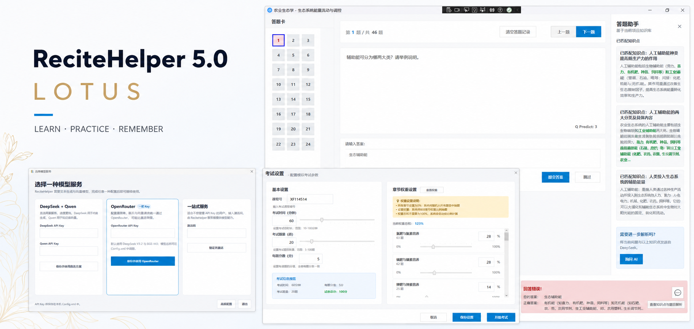
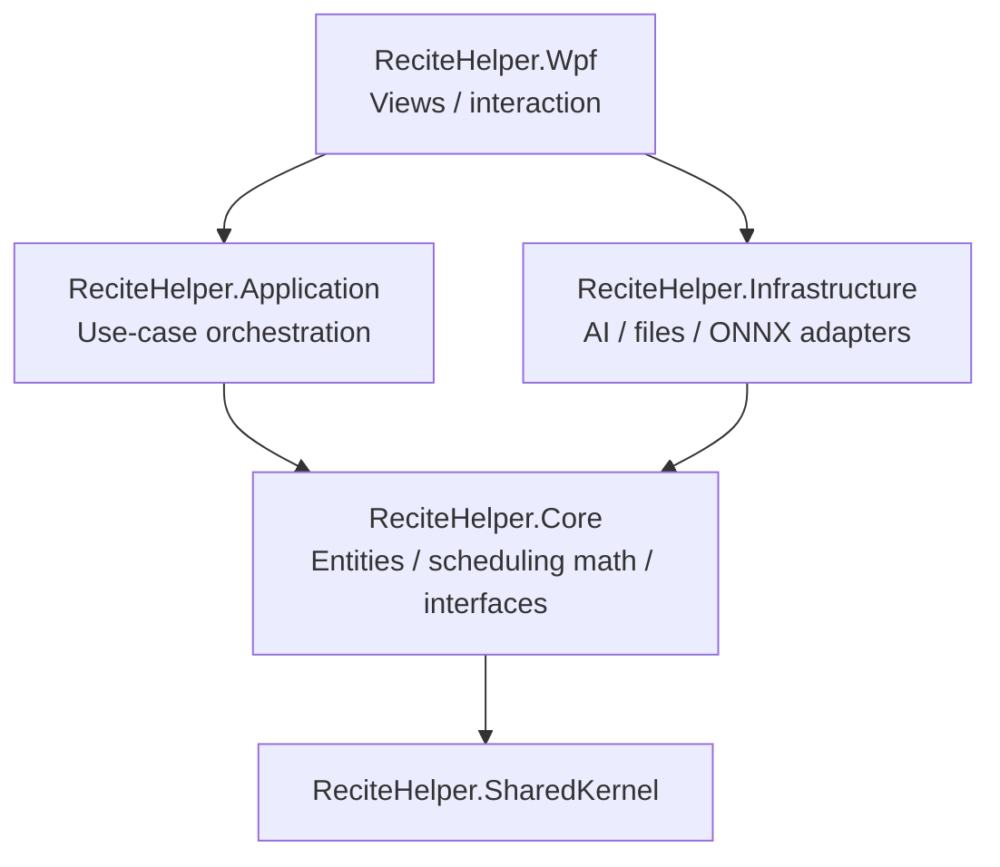

<p align="center">
  
</p>

<p align="center">
  <a href="README.md">简体中文</a> · <strong>English</strong>
</p>

<h1 align="center">ReciteHelper</h1>

<p align="center">
  <strong>Turn course materials into projects you can practise, search, and remember.</strong>
</p>

<p align="center">
  <a href="https://github.com/ClassTechStar/ReciteHelper/actions/workflows/dotnet.yml"></a>
  <a href="LICENSE"></a>
  
  
  
</p>

<p align="center">
  <a href="https://github.com/ClassTechStar/ReciteHelper/releases"><strong>Download ReciteHelper</strong></a>
  · <a href="docs/manual-en.md">User Guide</a>
  · <a href="docs/Dev/architecture.md">Architecture</a>
  · <a href="docs/algorithm-en.md">Review Algorithm</a>
  · <a href="https://github.com/ClassTechStar/ReciteHelper/issues">Report an Issue</a>
</p>

ReciteHelper is an open-source Windows desktop application for exam preparation, course learning, and knowledge organisation. It uses AI to read study materials, extract knowledge, and generate questions. A local knowledge base, automatic grading, mistake explanations, and personalised FSRS-6 scheduling then turn those materials into a complete learning loop.

AI is not an isolated chat box in ReciteHelper. It participates in document analysis, question generation, retrieval, and mistake assistance, while chapters, questions, learning records, and the vector knowledge base stay with the local project.

## Key Innovations

**1. FSRS-6 memory model with personalisation**
ReciteHelper ships the modern FSRS-6 scheduler (Difficulty–Stability–Retrievability): every question carries a three-dimensional memory state, recall probability is predicted from the forgetting curve, and a question is due once predicted recall drops below the target retention. After roughly 800 graded reviews the app refits the 21 model parameters against the user's own history in about a second — and only adopts the fit when it measurably improves predictions. See [Review Algorithm](docs/algorithm-en.md); implementation lives in `Core/Scheduling/`.

**2. Invisible AI across the whole pipeline**
AI participates in five stages — text extraction, atomic knowledge segmentation, question generation with post-processing repair, the local vector knowledge base, and mistake retrieval/explanation — without ever presenting the user a bare chat box.

**3. Offline semantic grading**
Term-definition and essay answers are graded by a local ONNX SBERT model (cached session plus memoised results), working with no network and no API key; a character-level similarity judge is the automatic fallback. Practice and exams share one grading standard.

**4. Project-local file knowledge base**
Every learning project embeds its own file-based vector store: atomic AI-generated knowledge points plus embeddings travel inside the `.rhproj` on save, import, and export. No database or vector service to deploy; mismatched embedding sources are re-embedded automatically.

**5. Three model access modes**
Direct DeepSeek + Qwen, single-key OpenRouter, or an activation-code hosted service — all routed through one `ModelAccess` state machine, with endpoints and model names overridable in configuration.

**6. Engineering for data correctness**
`.rhproj` files carry a schema version with a migration path and atomic saves; knowledge-base clustering uses fixed identity keys (no silent knowledge-point loss); configuration migrates to `%APPDATA%` with DPAPI-encrypted API keys; resource-center archives are validated for size, entry types, and manifest integrity before import.

## 5.0 Lotus

Version 5.0 reorganises the experience around the path from source material to durable knowledge:

- **FSRS-6 review scheduling** predicts recall from difficulty, memory stability, and elapsed time, prioritising questions that are about to be forgotten. Personal parameters can be fitted after enough review history is available.
- **Five question types** provide dedicated interactions and grading for single-choice, fill-in-the-blank, true/false, term-definition, and essay questions.
- **Paper import and an end-to-end exam flow** recognise exam sets from PDF, TXT, HTML, or MHTML and support chapter-weighted generation, timed exams, automatic grading, and mistake review.
- **A project-local knowledge base** retrieves relevant knowledge for each mistake and can request a grounded AI explanation when needed.
- **Flexible model access** supports direct DeepSeek + Qwen access, a single OpenRouter key, or a ReciteHelper hosted-service activation code.

## Workflow

```text
Import course material → Extract knowledge and generate questions → Practise / take exams
       → Retrieve and explain mistakes → Schedule the next review with FSRS-6
```

## Technical Architecture

ReciteHelper follows Clean Architecture: the domain core depends on no UI framework and no third-party SDK.



| Layer | Responsibility | Representative modules |
| --- | --- | --- |
| Core | Domain entities, FSRS-6 scheduling math, grading normalisation, all service interfaces (zero third-party dependencies) | `Scheduling/FsrsAlgorithm`, `Services/FillBlankTextNormalizer` |
| Application | Use cases: question generation, grading, review scheduling, personalisation | `ProjectCreationService`, `QuizService`, `FsrsReviewScheduler` |
| Infrastructure | Adapters: LLM SDKs, ONNX inference, file vector store, configuration encryption | `KnowledgeBaseService`, `SbertModelJudge`, `ConfigService` |
| Wpf | Views and interaction, DI composition | 17 windows, FlashCard study mode |

See the [architecture document](docs/Dev/architecture.md) for layering details, data flow, and security design.

## Engineering Quality

- **Automated tests**: xUnit unit tests cover FSRS-6 mathematical invariants, grading normalisation, exam-paper composition, the vector store, and configuration persistence. GitHub Actions runs build + tests on every push.
- **Release engineering**: `build.ps1` produces a clean publish (PDB-free, per-file SHA256 manifest, build report); pushing a tag automatically creates a GitHub Release.
- **Robustness**: global exception funnel with crash log; bounded LLM retries with partial-success semantics and progress reporting.
- **Security**: DPAPI-encrypted API keys with environment-variable indirection; imported archives are checked against zip bombs, path traversal, and dangerous file types; prompt-injection guardrails on retrieval-grounded answers.

## Screenshots

<table>
  <tr>
    <td width="62%">
      
      <br /><strong>Quiz and knowledge-base assistant</strong><br />Practice, automatic grading, relevant knowledge retrieval, and optional AI explanations in one view.
    </td>
    <td width="38%">
      
      <br /><strong>Exam settings</strong><br />Configure duration, question count, score, and chapter weights.
    </td>
  </tr>
  <tr>
    <td>
      
      <br /><strong>Knowledge-point study</strong><br />Browse knowledge by chapter and keep track of mastery.
    </td>
    <td>
      
      <br /><strong>Exam review</strong><br />Review answers and mistakes, then bring selected questions back into the learning project.
    </td>
  </tr>
</table>

## Model Services

When no valid model configuration is found, ReciteHelper opens a service-selection window on startup.

| Option | What you need | Characteristics |
| --- | --- | --- |
| DeepSeek + Qwen | A DeepSeek key and a Qwen key | Direct text-generation and embedding access; usually faster |
| OpenRouter | One OpenRouter key | Simpler setup; chat and embeddings share one gateway, but may be slower |
| Hosted service | A ReciteHelper activation code | No third-party API keys to manage; model access is provided by the server |

API keys are stored in the local `Config.xml` by default and may also reference environment variables. Text required by an AI feature is sent to the model provider you select; project files and the vector knowledge base remain local.

## Quick Start

1. Download the latest build from [Releases](https://github.com/ClassTechStar/ReciteHelper/releases).
2. Extract it and run `ReciteHelper.exe`.
3. Choose and configure a model service in the first-run window.
4. Import a text-based PDF, or merge DOCX, PPTX, PDF, and TXT material into a `.meg` file, then create a `.rhproj` learning project.

See the [English user guide](docs/manual-en.md) for complete setup and usage instructions.

## Build from Source

Install the [.NET 10 SDK](https://dotnet.microsoft.com/download/dotnet/10.0) and Visual Studio or JetBrains Rider with WPF support.

```powershell
git clone --recurse-submodules https://github.com/ClassTechStar/ReciteHelper.git
cd ReciteHelper
dotnet restore src/ReciteHelper.slnx
dotnet build src/ReciteHelper.slnx --configuration Release
dotnet run --project ReciteHelper.Wpf/ReciteHelper.Wpf.csproj
```

If the repository was cloned without its submodules, run:

```powershell
git submodule update --init --recursive
```

Run the unit tests:

```powershell
dotnet test src/ReciteHelper.slnx --configuration Release
```

## Documentation

| Document | Description |
| --- | --- |
| [Chinese user guide](docs/manual-cn.md) | Installation, configuration, and full feature guide |
| [English user guide](docs/manual-en.md) | English setup and usage instructions |
| [Architecture](docs/Dev/architecture.md) | Layering, data flow, and security design |
| [Review algorithm (中文)](docs/algorithm-cn.md) | FSRS-6 theory and personalisation |
| [Review algorithm](docs/algorithm-en.md) | FSRS-6 in English |

## Contributing

Issues, feature proposals, code, tests, and translations are all welcome:

1. Fork the repository and create a branch from `primary`.
2. Follow the existing code style and document behavioural changes.
3. Confirm that the Release build passes and `dotnet test` is green before submitting.
4. Open a Pull Request and link the relevant issue or include UI screenshots.

Please read the [Code of Conduct](CODE_OF_CONDUCT.md) before contributing. Use [GitHub Issues](https://github.com/ClassTechStar/ReciteHelper/issues) for discussion and bug reports, or email `arab@methodbox.top`. QQ group: `1053379975`.

## License

ReciteHelper is distributed under the [GNU AGPL v3.0 or later](LICENSE). If you distribute a derivative work or provide a network service based on this project, follow the licence's corresponding source requirements.

## Acknowledgements

Thanks to Sati, Mrwhite3142, oife, AcE77505, and every contributor who has helped improve file handling, compatibility, and stability.

<p align="center">
  
  &nbsp;&nbsp;&nbsp;
  
</p>

<p align="center">
  If ReciteHelper helps you, consider giving the project a Star.
</p>

[](https://github.com/ClassTechStar/ReciteHelper/stargazers)
