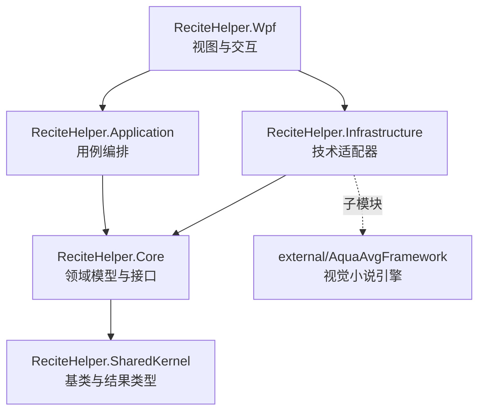
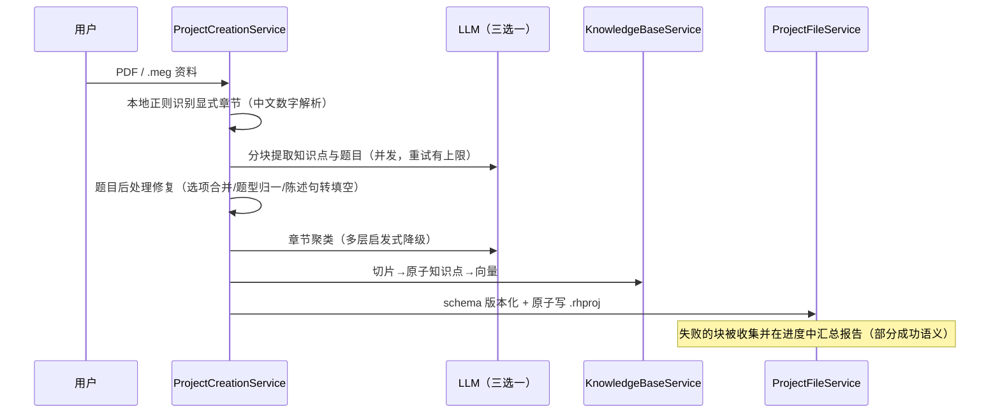
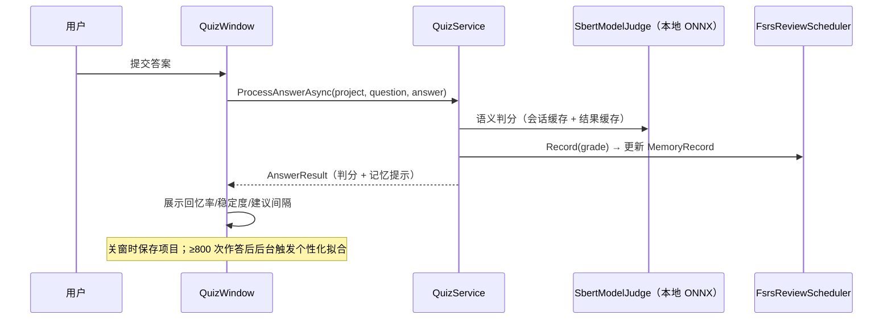

# ReciteHelper 技术架构

> 本文面向开发者与评审，说明 ReciteHelper 的分层设计、核心数据流、健壮性与安全设计。配合 [复习算法说明](../algorithm-cn.md) 阅读。

## 1. 总体结构

解决方案 `src/ReciteHelper.slnx` 采用 Clean Architecture 五层结构，依赖方向严格单向：

| 项目 | 职责 | 依赖 |
| --- | --- | --- |
| `ReciteHelper.SharedKernel` | 实体基类、值对象基类、执行结果类型 | 无 |
| `ReciteHelper.Core` | 领域实体（`Project`/`Chapter`/`Question`/`MemoryRecord`）、FSRS-6 调度数学（`Scheduling/`）、判分与填空归一化（`Services/`）、全部服务接口（`Interfaces/`，26+ 个） | SharedKernel，**零第三方包** |
| `ReciteHelper.Application` | 用例编排：建项目管线、判分、复习调度、FSRS 个性化拟合 | Core |
| `ReciteHelper.Infrastructure` | 技术适配器：LLM SDK（LlmTornado/OpenAI）、本地 ONNX 推理（SBERT/XGBoost）、文件向量库、DPAPI 配置加密、PDF/Office 文本抽取 | Core + AquaAvgFramework |
| `ReciteHelper.Wpf` | 17 个窗口的视图与交互、DI 组装（Microsoft.Extensions.DependencyInjection） | Application + Infrastructure + AquaAvgFramework |

**关键约束**：Core 不引用任何第三方 NuGet 包——调度算法、判分归一化、题目后处理全部是可独立测试的纯逻辑；所有跨层通信面向 Core 中定义的接口（依赖倒置）。

## 2. 核心数据流

### 2.1 项目创建管线（AI 密集）

- 章节识别优先走**本地正则**（含"第一百二十三章"式中文数字解析），AI 切分仅作补充，近重复章按向量相似度合并。
- LLM 失败块整轮重试至多 3 轮，最终失败的部分跳过并在进度窗口汇总——**已付费生成的内容不会因个别块失败而丢弃**。

### 2.2 练习与记忆闭环

防重入保障：已判分的题目拒绝重复提交；FSRS 记忆状态每题只推进一次。

### 2.3 考试闭环

组卷（`ExamPaperService`，30% 选择 + 35% 填空 + 20% 名词解释 + 其余解答，章节权重幂抽样）→ 限时作答（双页渲染引擎）→ 交卷时**逐题判分一次**并缓存结论（主观题走与练习相同的 SBERT 语义判分，模型缺失自动降级字符级算法）→ 回顾页复用缓存结论，错题可一键归并回学习项目。

### 2.4 模型访问路由

`Core/Configuration/ModelAccess` 是唯一的三态路由器：

| 状态 | 条件 | 文本生成 | 向量 |
| --- | --- | --- | --- |
| `DeepSeekAndQwen` | DeepSeekKey 与 QwenKey 均配置 | DeepSeek（端点/模型可配置） | Qwen 兼容模式 |
| `OpenRouter` | 仅 OpenRouterKey | OpenRouter Chat | OpenRouter Embedding |
| `Hosted` | 激活码/LicenseId | 托管服务端 | 托管服务端 |

所有 AI 消费方（题目生成、知识库、错题解析）统一经此路由；知识库还会为每条向量记录来源模型，来源切换时自动重嵌入整库，杜绝不同语义空间的向量混用。

## 3. 健壮性设计

| 场景 | 机制 |
| --- | --- |
| LLM 调用失败 | 分块重试至多 3 轮（指数场景可控），最终失败跳过并汇总报告；AI 聚类失败降级为平铺章节 |
| 整卷导入个别坏题 | 按题校验、跳过并在导入报告中列明原因，不再"一题不合格全盘失败" |
| 进程崩溃 | 全局异常兜底（Dispatcher/AppDomain/UnobservedTask 三级）+ `%LOCALAPPDATA%` 崩溃日志 |
| 写文件中断 | `.rhproj`、考试卷库、配置、最近项目全部 tmp+Move 原子写 |
| 旧版本数据 | `.rhproj` 带 `schema_version`，高版本文件拒绝打开并提示升级；旧 SM-2 作答历史惰性重放迁移为 FSRS 状态 |
| 本地模型缺失 | SBERT 判分自动降级字符级相似度；XGBoost quality 模型缺失回退传统估算 |
| 大任务重复触发 | 交卷 `_isSubmitted` 防重入；答题提交按钮 await 期间禁用 + 已判分守卫 |

## 4. 安全设计

- **密钥保护**：API Key 保存时经 DPAPI（当前用户范围）加密，磁盘上以 `enc:v1:` 前缀存储；支持 `%Environment.GetEnvironmentVariable(...)%` 占位符完全避免落盘；配置持久化克隆由反射测试逐字段守护（`ConfigServicePersistTests`），新增字段遗漏会直接测试失败。
- **配置文件位置**：首次启动从安装目录迁移到 `%APPDATA%\ReciteHelper`，规避 Program Files 写权限问题。
- **导入内容防护**：资源中心/本地导入的 `.rhp` 压缩包在解压前校验——条目数上限、解压总量上限（防压缩包炸弹）、路径穿越、可执行扩展名黑名单、manifest 一致性；下载流式执行并强制大小上限。
- **提示词注入防护**：知识库检索结果的注入指令在错题解析提示词中被显式忽略。

## 5. 测试策略

- **单元测试**（xUnit，CI 全量执行）：FSRS-6 数学不变量（标定性质 R(S,S)=0.9、间隔反演、clamp 边界、难度单调性）、旧数据迁移重放、学习日历跨日语义、`ModelAccess` 三态解析、填空归一化三策略、组卷配比与题型排除、向量库维度过滤与持久化往返、配置持久化字段完整性。
- **构建门禁**：GitHub Actions 在 push/PR 时执行 Release 构建 + 全部测试；tag 推送自动发布（去除 PDB、逐文件 SHA256 清单、构建报告）。
- **可测试性来源**：调度算法、判分归一化、题目后处理全部位于零依赖的 Core；AI 与文件 IO 全部隔离在 Infrastructure 适配器内，通过接口注入。

## 6. 性能要点

- SBERT 判分：ONNX 会话常驻（进程内单例），成对文本单次批推理，判分结果有界缓存——判分从"每题一次模型加载"降为微秒级查表。
- 向量库：批量并发 embedding（批 10、并发 4）；维度不匹配向量在检索时被过滤。
- 建项目：分块并发生成（并发 8–16）、KB 批量向量化；结构化章节按章并发。
- 个性化拟合：后台线程执行（约一秒），不阻塞 UI。
